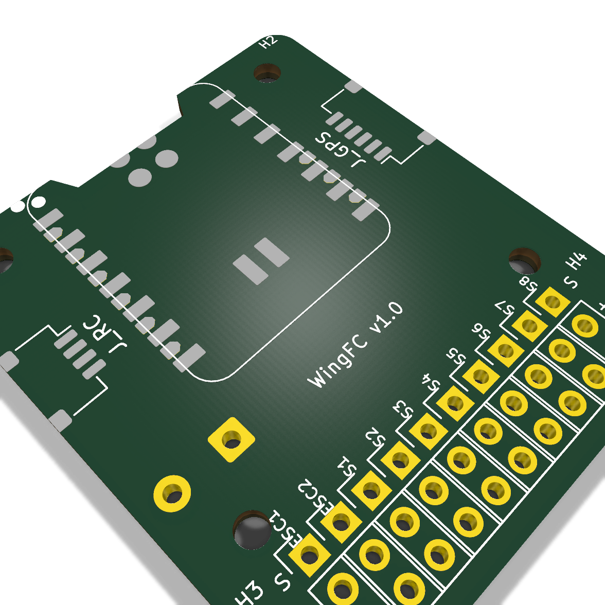
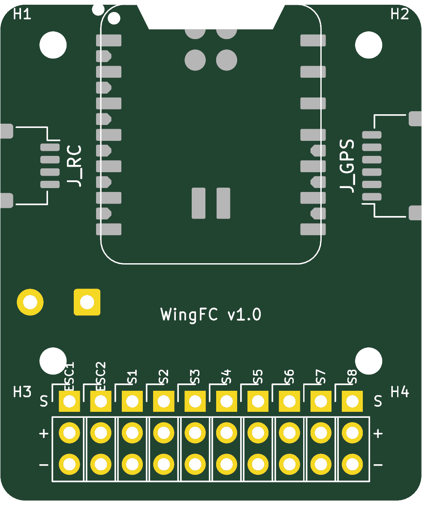
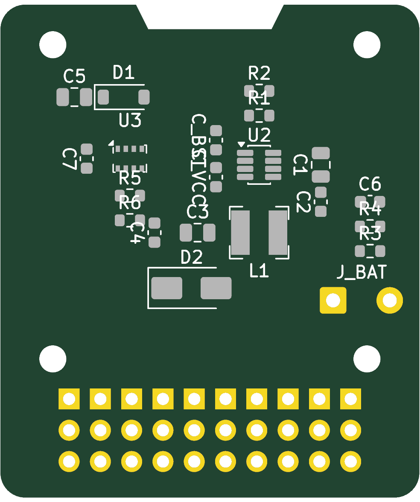

# WingFC Hardware Carrier Board

Official hardware carrier board design, schematics, PCB layout, and mechanical CAD for the **WingFC** open-source flight controller ecosystem.

Engineered specifically for sub-250g FPV flying wings, acrobatic wings, and compact autonomous UAVs, this carrier board hosts the **Seeed Studio XIAO nRF52840 Sense Plus** and breaks out all high-power actuation, serial links, and power regulation onto an ultra-compact footprint.

---

## 3D Board Visualizations

| Isometric 3D View | Top View | Bottom View |
| :---: | :---: | :---: |
|  |  |  |

---

## Key Hardware Features

- **Standard 25.5 × 25.5 mm Whoop Mounting Pattern:** Fits standard micro-quad and fixed-wing carrier bays with 4× M2 vibration-isolated mounting holes (`H1`–`H4`).
- **Compact Airframe Profile:** Only **34.0 mm wide × 40.0 mm long** with chamfered corners for low drag and tight fuselage bays.
- **Edge-Mounted North-Facing USB-C Port:**
  - MCU rotated so the USB-C receptacle faces forward into free air.
  - Dedicated $12.0\,\text{mm} \times 2.0\,\text{mm}$ recessed access notch ensures standard USB-C cables plug in flush without mechanical collision.
- **10 Actuator Channels (2 ESCs + 8 Servos):**
  - Full $3 \times 10$ $2.54\,\text{mm}$ header block (Signal / +5V / GND) along the rear edge.
  - Channels `ESC1` and `ESC2` driven by `PWM0` (50–400 Hz analog PWM or DShot).
  - Servos `S1`–`S4` driven by `PWM1` (Elevons, Rudder, Flaps).
  - Servos `S5`–`S8` driven by `PWM2` (Auxiliary, Pan/Tilt, Payload Drop).
- **Outward-Facing JST-SH Quick-Connect Sockets:**
  - **RC Receiver (`J_RC`):** 4-pin horizontal JST-SH on the West flank (5V, GND, UARTE0 TX/RX for CRSF/ELRS/iBus).
  - **GPS & Navigation (`J_GPS`):** 6-pin horizontal JST-SH on the East flank (5V, GND, UARTE1 TX/RX for NMEA GPS, TWISPI1 SDA/SCL for external compass).
- **High-Efficiency 5V / 2A Synchronous BEC:**
  - Monolithic Power Systems **MP2315** high-efficiency step-down buck regulator on the bottom layer.
  - Supports 2S to 6S LiPo input voltages (up to 24V).
  - High-current Bourns SRN4018 4.7µH shielded power inductor.
- **Integrated High-Precision Barometer:**
  - Onboard Infineon **DPS310** 24-bit barometric pressure sensor on the secondary I2C bus (`TWISPI1`).
  - Enables sub-meter altitude hold and autonomous vertical Kalman filtering.
- **Multi-Stage Protection & Battery Monitoring:**
  - Littlefuse **SMAJ5.0A** TVS diode absorbs voltage transients and inductive spikes.
  - Diodes Inc **B0520W** Schottky barrier diode provides reverse-current isolation to the MCU.
  - 11:1 precision resistor divider (100kΩ / 10kΩ + 100nF filtering) connected to SAADC `AIN7` (`D16` / `P0.31`) for LiPo pack telemetry.

---

## Pinout & Electrical Allocation

| Header / Pin | Label | nRF52840 Pin | Peripheral | Function |
| :--- | :--- | :--- | :--- | :--- |
| **ESC 1** | `M1` | `P0.29` (`D3`) | `PWM0` Ch 0 | Motor 1 (DShot / PWM) |
| **ESC 2** | `M2` | `P1.13` (`D8`) | `PWM0` Ch 1 | Motor 2 / Differential Thrust |
| **Servo 1** | `S1` | `P0.02` (`D0`) | `PWM1` Ch 0 | Elevon Left / Aileron |
| **Servo 2** | `S2` | `P0.03` (`D1`) | `PWM1` Ch 1 | Elevon Right / Elevator |
| **Servo 3** | `S3` | `P0.28` (`D2`) | `PWM1` Ch 2 | Rudder / V-Tail |
| **Servo 4** | `S4` | `P1.14` (`D9`) | `PWM1` Ch 3 | Flap Left / Aux |
| **Servo 5** | `S5` | `P1.15` (`D10`)| `PWM2` Ch 0 | Aux / Pan Servo |
| **Servo 6** | `S6` | `P0.15` (`D11`)| `PWM2` Ch 1 | Flap Right / Tilt Servo |
| **Servo 7** | `S7` | `P0.19` (`D12`)| `PWM2` Ch 2 | Aux / Gear Retract |
| **Servo 8** | `S8` | `P1.01` (`D13`)| `PWM2` Ch 3 | Payload Drop / Aux |
| **RC Connector** | `J_RC` | `P1.11` / `P1.12` | `UARTE0` | CRSF / ELRS @ 420k or iBus @ 115.2k |
| **GPS Serial** | `J_GPS` | `P0.09` / `P0.10` | `UARTE1` | NMEA GPS @ 115.2k |
| **External I2C**| `J_GPS` | `P0.04` / `P0.05` | `TWISPI1` | QMC5883L Compass / Ext. Sensors |
| **Battery ADC** | `VBAT_SENSE`| `P0.31` (`D16`)| `SAADC` AIN7 | 11:1 LiPo Voltage Sensing |

---

## KiCad Project Structure

The KiCad project is located in [`kicad/`](kicad/):
- `WingFC.kicad_pro`: KiCad project management file.
- `WingFC.kicad_sch`: Master schematic (includes onboard power supply, filtering, and breakout nets).
- `WingFC.kicad_pcb`: 4-layer PCB layout with dedicated power planes and signal routing.
- `footprints/`: Self-contained project footprint libraries.

---

## Compatible Firmware

This carrier board is fully supported by the **WingFC-rs** bare-metal Rust flight controller firmware:
👉 **[ferrox-rc/wingfc-rs](https://github.com/ferrox-rc/wingfc-rs)**

---

## License

Hardware design files, schematics, PCB layouts, and documentation are licensed under the [MIT License](LICENSE).
